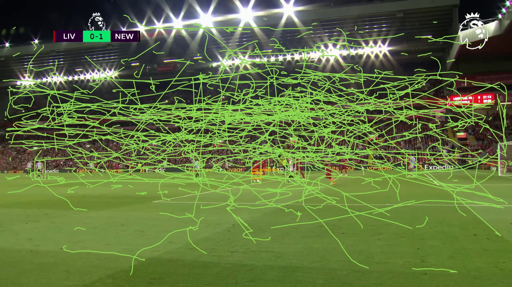

# Touchline Sports Intelligence Platform

The first implementation slice is an interactive football analyst workspace for 10-minute development recordings.



## Engineering case study

Touchline is a local-first sports intelligence prototype that turns short football recordings into reviewable tracking video, player and ball observations, tactical-pitch positions and conservative event candidates. It combines a React analyst interface, FastAPI/SQLite API, GPU-backed YOLO detection, BoT-SORT tracking, a separately trained small-ball detector, H.264 rendering and timestamped camera calibration.

The central engineering constraint is honest analysis from ordinary broadcast footage. The current system detects camera cuts, expires invalid pitch calibrations, supports partial-pitch calibration segments and labels uncertain output for analyst review. Automatic shot classification is deliberately withheld until calibrated world-coordinate trajectories can replace unreliable screen-edge heuristics.

### Measured validation

- Dedicated 1280 px ball model: precision 0.745, recall 0.527, mAP50 0.619 on the provided validation split.
- Main detector: player mAP50 0.962 on the same split.
- Real 30-second broadcast segment: 150 sampled frames, 935 player observations, 70% observed-or-recovered ball visibility and 182.6 MB peak allocated VRAM.
- Regression checks: backend API tests, frontend lint/build and browser workflow.

These are development results on a limited mixed-domain dataset, not production claims. Dataset and split limitations are documented in `docs/DATASET_REGISTER.md`.

## Run locally

```powershell
cd apps/web
npm install
npm run dev
```

Start the API first, then open the local address printed by Vite. Use **Open video** to load an MP4, MOV or WebM from your computer. The analyst workspace creates its development organization and match automatically, then stores events in the API. If the API is unavailable, it continues in browser-local fallback mode.

## Implemented in the first slice

- Responsive dark analyst workspace
- Local video loading and native playback
- Synchronized scrubber and source timestamp
- Timeline event markers and seeking
- Manual Pass, Shot, Recovery, Press and Note events
- Event search, selection, confirmation and deletion
- API persistence with automatic local fallback
- Immutable revisions for confirmations and archived events
- Validated MP4, MOV and WebM uploads stored under `data/media`
- Durable detection jobs with a mock pipeline and a local YOLO adapter
- Tactical pitch view and annotation-tool shell
- Editable home and away team names persisted with the match
- Generated H.264 tracked video with detection labels, stable IDs and movement trails
- Original/tracked playback switch and tracked-video download
- Jersey-colour team clustering with custom home and away labels
- Four-point camera calibration and synchronized tactical-pitch positions
- Review-only pass and shot candidates derived from ball motion and possession transitions
- Dedicated 1280 px ball detector with overlapping-tile inference and short-gap temporal recovery

## Validation

```powershell
cd apps/web
npm run lint
npm run build
```

## Run the API

From the project root:

```powershell
.\.venv\Scripts\Activate.ps1
cd apps\api
alembic upgrade head
uvicorn app.main:app --reload --port 8000
```

API documentation is available at `http://127.0.0.1:8000/docs` while the server runs.

The local environment uses SQLite. The schema and async data layer are compatible with PostgreSQL through the `TOUCHLINE_DATABASE_URL` setting. See `apps/api/.env.example`.

The API currently provides:

- Organization-scoped matches
- Ten-minute video metadata and rights status
- Timestamped football events
- Immutable event revision history
- Analyst and AI provenance fields
- Tenant-isolation checks

Run backend tests with:

```powershell
cd apps\api
..\..\.venv\Scripts\python.exe -m pytest
```

The frontend is connected to these endpoints. Set `VITE_API_URL` from `apps/web/.env.example` when the API runs on a different host or port.

Opening a video uploads it after the browser reads its duration. Development uploads are limited to 10 minutes, checked by content type and file signature, hashed with SHA-256 and stored outside Git. **Run detector** executes the local football checkpoint with CUDA and ByteTrack in the isolated `.venv-vision` environment. When processing finishes, the Analysis view presents track counts, ball visibility, per-minute detection activity and processing metrics. The Video view draws time-synchronized player, ball and referee tracks over the recording. These outputs remain experimental and require analyst review, especially ball detections.

The first synthetic 640px GPU benchmark measured a median 11.14 ms inference call (89.75 calls/second) and 77.6 MB peak allocated VRAM on the RTX 3050. This excludes video decoding and uses an empty synthetic frame, so it is only a toolchain baseline. The end-to-end video worker also completed through the API on a generated three-second MP4.

The first one-epoch fine-tuning smoke test also passed on the GPU in 28.32 seconds and wrote a checkpoint. It used four generated images, so it proves training wiring rather than accuracy. See `docs/VISION_BASELINE.md` for the environment, measurements, reproduction commands and promotion gate.

A first football pilot has now completed on 612 audited labeled images. The main 960 px model reached player mAP50 0.962. A separate ball-only model trained at 1280 px reached ball precision 0.745, recall 0.527 and mAP50 0.619 on the provided validation split. The worker runs that checkpoint over four overlapping image tiles and can bridge up to four missing sampled frames using recent ball motion. The validation data mixes real broadcasts with game footage, so results remain experimental and require analyst review. See `docs/DATASET_REGISTER.md` for licensing and split limitations.
